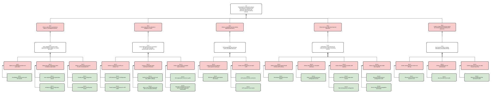

# Assurance Cases for Software Security Engineering

[Github Link](https://github.com/HapticLazier2/CSCI-8420-Group-2)

[ProjectBoard Link](https://github.com/users/HapticLazier2/projects/1)

CSCI-8420 Group 2 · System of interest: CrowdSec Security Engine (v1.8.x) · Environment: enterprise network (Multi-server LAPI)

### **3. Top-Level Claim 3**
#### C3: Remediation components enforce only authentic, unaltered LAPI decisions and receive new decisions within one polling interval.
#### Contributor: Leonard Meredith
#### Assurance Case Diagram:

Branch views (easier to read at full size)

- [R3.1 — Rogue or unvalidated machines](./assurance_cases/Claim_Leonard_R3_1.svg)
- [R3.2 — Tampering in transit](./assurance_cases/Claim_Leonard_R3_2.svg)
- [R3.3 — Unauthorized decision deletion](./assurance_cases/Claim_Leonard_R3_3.svg)
- [R3.4 — Decisions stop reaching bouncers](./assurance_cases/Claim_Leonard_R3_4.svg)
- [R3.5 — Stolen bouncer keys](./assurance_cases/Claim_Leonard_R3_5.svg)

C3 covers UC-3 (Retrieve & Enforce Decisions) and its requirements SR-3.1 to SR-3.6. Every firewall and reverse-proxy bouncer in our enterprise acts on whatever LAPI tells it, so a forged decision can lock out partners, a stripped or deleted decision lets an attacker through, and a stalled LAPI means new attacks are never blocked. The five top-level rebuttals answer the misusers we found against UC-3: the Rogue-Agent Registrant (R3.1), the Network-Positioned Interceptor (R3.2), a validated machine misused to remove bans (R3.3), the Pre-Auth LAPI Flooder (R3.4) and the Bouncer-Key Thief (R3.5).

#### Usefulness of AI Prompt:
I used the instructor's claim-phrasing prompt on my first draft of the claim:

You are an expert software security engineer. Your job is to suggest corrections or improvements in the phrasing of assurance claims. Claims concern critical properties that are risk-related. High confidence is needed in their realization. A claim is always worded with a predicate. Avoid claims about the supporting method/techniques.
Bad claim: "The system uses AES encryption." Why? Because it is not interesting; just the technology is just a means to an end, but does not provide assurance that it can actually keep the information confidential.
Claim should be a reasonable goal (outcome). Good claim: "The system minimizes information disclosure during communication"
Good Claim Checklist: 1. Includes an entity relevant to the argument, 2. a critical property of the entity, 3. a value for the property and related uncertainty.
Use this statement as a potential claim for analysis. Explain why or why not this statement is a good claim.
"""
Remediation components enforce only authentic, unaltered LAPI decisions and receive new decisions within one polling interval.
"""

> **[DRAFT — rewrite in your own words after running the prompt yourself]** The prompt confirmed the claim passes the checklist: it names an entity (remediation components), a critical property (decision integrity), and a measurable value (only authentic, unaltered decisions, delivered within one polling interval). It also pointed out that the claim combines two properties, integrity and timeliness, which makes it harder to defeat in one argument. I kept both because a bouncer that stops receiving decisions fails just as badly as one that receives forged ones, but I gave timeliness its own branch (R3.4) so the two arguments stay separate. The prompt was most useful for checking wording; it could not tell me which defeaters were real for CrowdSec, so those came from our misuse cases and documentation review.

---

#### Alignment of Evidence and Identified Gap: Leonard Meredith

**Evidence either Available or Requiring Minimal Effort.** CrowdSec already provides the feature behind these items; the effort is configuring it correctly and recording the result.

- **E3.1.1 Unvalidated-machine alert-push test results:** New machines are created unvalidated and cannot push alerts until `cscli machines validate` (SR-3.5). A short test against a fresh registration produces this evidence.
- **E3.1.3 `allowed_ranges` configuration review:** LAPI refuses to start with auto-registration enabled and no `allowed_ranges`, so the setting always exists. The review checks that the ranges are narrow; the Kubernetes install page's example allows every private range (DR-12).
- **E3.4.1 Decompressed body-limit test results:** Since the fix for CVE-2026-44981, LAPI caps decompressed bodies at 2 MiB unauthenticated and 50 MiB authenticated. A gzip-bomb test against `/v1/watchers/login` confirms the cap holds.
- **E3.5.1 Bouncer key inventory (`cscli bouncers list`):** LAPI records each bouncer with its IP and last-pull time (SR-3.3). Gap: the multi-server guide encourages sharing one key across bouncers (DR-8); the documentation should recommend one key per bouncer.
- **E3.5.2 Key revocation test results:** `cscli bouncers delete` revokes a single key (SR-3.1). The test confirms a deleted key is refused while other bouncers keep working.
- **E3.3.2 LAPI network access control list:** An enterprise firewall control rather than a CrowdSec feature, so it is available from the network team.

**Evidence Requiring Additional Effort.** These items need a running deployment, a dedicated test, or a fix in CrowdSec or its documentation before they can be produced.

- **E3.1.2 Auto-registration token generation record:** The documentation's token example is a literal placeholder string with no generation command (DR-8). Gap: add `openssl rand -hex 32` to the multi-server guide, as the bot-detection page already does.
- **E3.1.4 `trusted_proxies` configuration audit** and **E3.1.5 X-Forwarded-For spoofing test results:** `trusted_proxies` is undocumented, and if it is left out while forwarded headers are on, LAPI trusts every client's `X-Forwarded-For` (DR-4). That lets a client choose the IP checked against `allowed_ranges`. Gap: document the setting and its default; until then, the audit must confirm it lists only the real proxy, and the test must show a spoofed header is ignored.
- **E3.2.1 LAPI and bouncer TLS configuration audit** and **E3.2.2 Packet capture of bouncer-to-LAPI traffic:** TLS is supported but off by default, and the documentation says it is unnecessary on a LAN (DR-1). Gap: remove that advice and make TLS the default in the multi-server guide.
- **E3.2.3 Audit of `insecure_skip_verify` and `SSL_VERIFY` settings** and **E3.2.4 Man-in-the-middle test results with an untrusted certificate:** The documentation tells readers to enable `insecure_skip_verify` for self-signed certificates, and in code that flag also disables verification toward CAPI (DR-2). The NGINX bouncer's `SSL_VERIFY` also covers LAPI calls, which its documentation omits (DR-5). Gap: replace the advice with a `ca_cert_path` example and document the scope of both settings.
- **E3.2.5 CRL deployment record (`crl_path`):** CRL checking happens only when `crl_path` is set, and the documentation describes its failure behavior incorrectly (DR-3). Gap: rewrite the revocation section from the code.
- **E3.2.6 Revoked-certificate test results with the OCSP responder unreachable:** From our code reading, OCSP fails open: a revoked certificate is accepted when the responder cannot be reached, while the log says the opposite (DR-3). This test would currently fail. Gap: report privately to `security@crowdsec.net`; until fixed, rely on CRL checking.
- **E3.3.1 Decision-deletion authorization test results:** `trusted_ips` guards only alert deletion; any validated machine can delete decisions from any address (DR-7). This test would currently fail, so R3.3.1 stays partly open and C3.3 rests on network placement (E3.3.2, E3.3.3). Gap: ask the maintainers whether decision deletion should also respect `trusted_ips`, and document which routes it protects.
- **E3.3.3 LAPI exposure scan results:** Requires scanning the network from untrusted segments to confirm LAPI is unreachable from them.
- **E3.4.2 `listen_uri` and published-port configuration record:** Packages bind LAPI to loopback, but the official Docker image binds to `0.0.0.0` and the image README publishes the port on every interface (DR-11). Gap: bind the README examples to `127.0.0.1`.
- **E3.4.3 Load test results at peak alert volume** and **E3.4.4 Rate-limiting proxy configuration:** LAPI has no rate limiting, so capacity has to be measured and protected by a proxy in front of it. Gap: no built-in rate limiting in CrowdSec.
- **E3.4.5 Bouncer polling-interval configuration audit** and **E3.4.6 End-to-end decision propagation test results:** Requires a test that creates a decision and times its arrival at each bouncer type in the deployment.
- **E3.5.3 Bouncer configuration file permission audit:** Only the HAProxy SPOA page explains how to protect the file that holds a bouncer's API key (DR-8). Gap: add the same guidance to the other bouncer pages.

**Summary.** Of 23 evidence items, 6 can be produced with little effort because CrowdSec already provides the control. The other 17 need testing or configuration work, and three areas (E3.1.4/E3.1.5, E3.2.6, E3.3.1) are expected to fail on a default v1.8.1 deployment. Those three areas are the strongest contribution candidates: two are documentation fixes, and the OCSP fail-open and decision-deletion scope should go to the maintainers first.

### Reflection on the AI prompt's usefulness

### References

#### Kowshik's Reflection

#### Trung's Reflection

#### Leonard's Reflection

#### Mujib's Reflection

#### Hrudhay's Reflection
