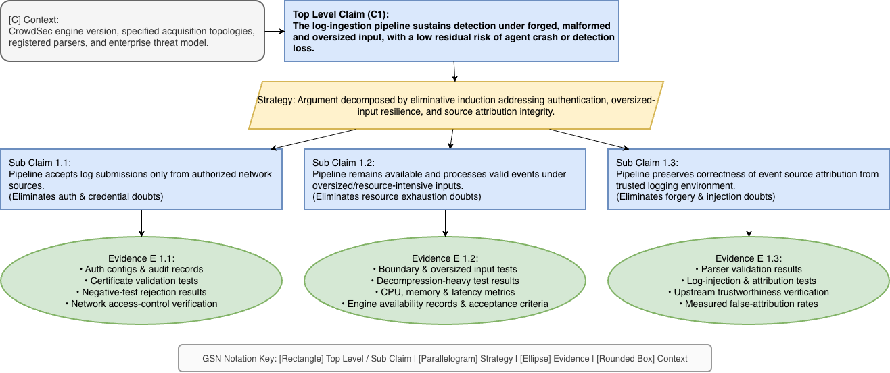
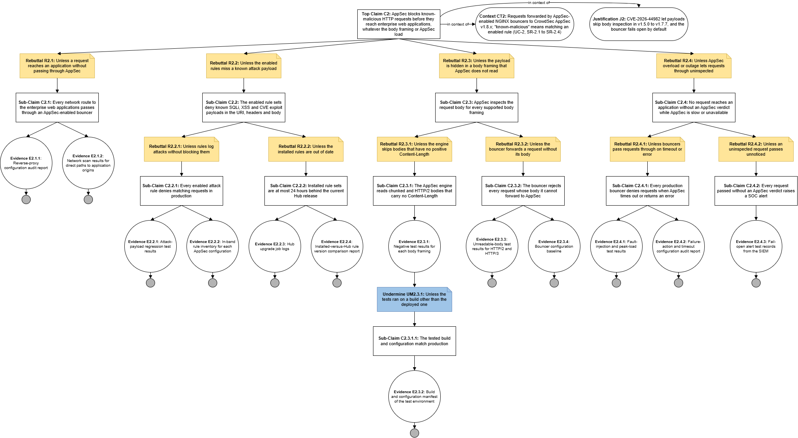
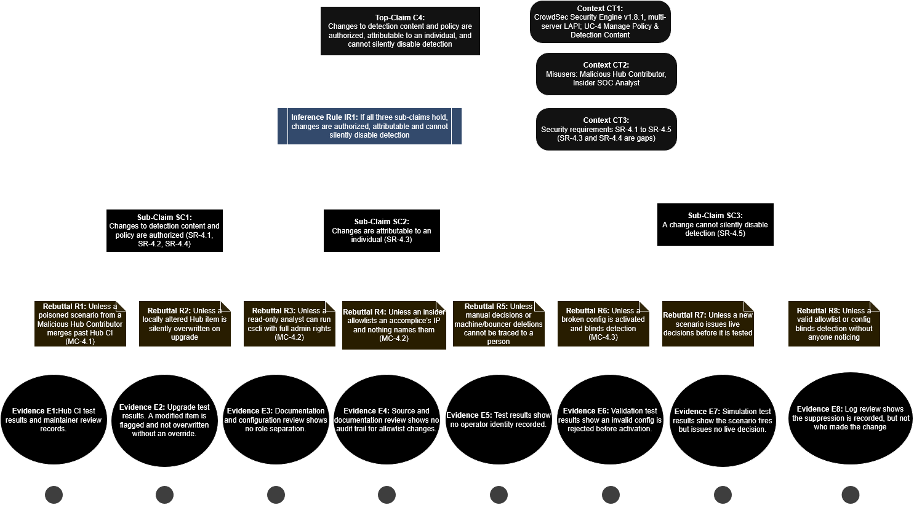
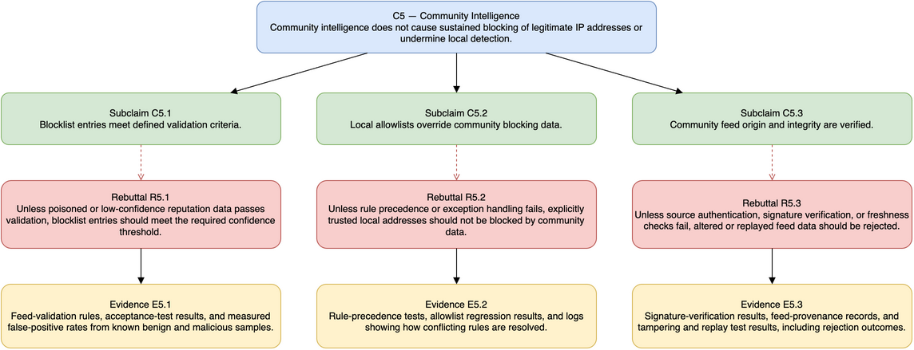

# Assurance Cases for Software Security Engineering

[Github Link](https://github.com/HapticLazier2/CSCI-8420-Group-2)

[ProjectBoard Link](https://github.com/users/HapticLazier2/projects/1)

CSCI-8420 Group 2 · System of interest: CrowdSec Security Engine (v1.8.x) · Environment: enterprise network (Multi-server LAPI)

## Claim - Log Ingestion Resilience and Integrity

## Narrative

The CrowdSec log ingestion pipeline receives and processes security logs that support the detection of suspicious activity and potential threats. In the assumed enterprise environment, forged, malformed, and oversized log inputs may threaten the pipeline's availability and its ability to process valid security events. The assurance argument addresses whether the pipeline can sustain detection under these adversarial conditions while maintaining a low residual risk of agent crash or detection loss. The argument is supported by subclaims covering network log-source authentication, resilience to oversized inputs, and the integrity of source attribution. Planned evidence includes configuration reviews, adversarial testing, resource measurements, and detection-continuity results.

## C1 — Top-Level Claim

The log-ingestion pipeline sustains detection under forged, malformed and oversized input, with a low residual risk of agent crash or detection loss.

### C1 assurance case diagram


*Figure — Assurance case for claim C1. The editable file is `final-top-level-C1.drawio`.*

---

### SC 1.1 — Network Log Source Authentication

The CrowdSec Log Ingestion Pipeline accepts log submissions only from network sources authorized under the defined security policy.

### R 1.1 — Unauthorized Log Submission

**R 1.1.1** Unless network sources lack adequate authentication

**R 1.1.2** Unless authentication controls are misconfigured or bypassed

**R 1.1.3** Unless valid credentials are compromised

### E 1.1 — Authentication Verification Records

- Network log-source authorization requirements.
- Datasource authentication configurations and audit records.
- Authentication and certificate-validation test results, where applicable.
- Negative-test results demonstrating rejection of unauthorized submissions.
- Network access-control verification results for sources without native authentication.

---

### SC 1.2 — Oversized Input Resilience

The CrowdSec Log Ingestion Pipeline remains available and continues processing valid security events when exposed to oversized or resource-intensive log inputs under defined operational conditions.

### R 1.2 — Resource Exhaustion and Processing Disruption

Here are short, intuitive rebutting defeaters for the statement, structured using eliminative induction for a readable diagram:

**R 1.2.1** Unless memory exhausted by oversized payload

**R 1.2.2** Unless CPU overwhelmed by decompression bomb

**R 1.2.3** Unless parser process crashes on failure

**R 1.2.4** Unless valid event queue experiences timeout or bottleneck

### E 1.2 — Input Resilience Test Results

- Boundary-value and oversized-input test results.
- Decompression-heavy input test results, where applicable.
- CPU, memory, and processing-latency measurements.
- Load-test results and engine availability records.
- Verification results demonstrating continued processing of valid events.
- Test results evaluated against predefined resource and availability acceptance criteria.

---

### SC 1.3 — Log Source Attribution Integrity

The CrowdSec Log Ingestion Pipeline preserves the correctness of security-event source attribution when processing log entries from the configured and trusted logging environment.

### R 1.3 — False Source Attribution

**R 1.3.1**  Unless attacker-controlled log fields bypass validation

**R 1.3.2**  Unless upstream logging systems are compromised

**R 1.3.3**  Unless source information is forged prior to pipeline ingestion

### E 1.3 — Source Attribution Verification Records

- Parser validation results for valid, malformed, and forged log entries.
- Log-injection and source-attribution test results.
- Verification results for the trustworthiness of upstream source information.
- Tests covering trusted and untrusted source addresses.
- Measured false-attribution rates evaluated against predefined acceptance criteria.
- Verification results for allowlist handling and suppression logging, where applicable.

---

### Assurance Scope and Assumptions

- The claims apply to the specified CrowdSec version, configured acquisition sources, installed parsers, and detection scenarios in the assumed enterprise environment.
- Authorization and input-resilience requirements are evaluated separately for each in-scope acquisition method.
- Successful parsing does not, by itself, establish the authenticity of a source IP address or other log field.
- Detection effectiveness is evaluated against a defined set of malicious-event test cases and operational acceptance criteria.
- Evidence listed above is planned evidence until the corresponding tests and reviews have been completed.
- Each claim is considered supported only when the collected evidence meets its acceptance criteria and the identified rebuttals have been adequately addressed.

#### Prompt 1: claim wording
I prompted Claude Sonnet 5.5 Model with the following prompt:
```text
You are an expert software security engineer. Your job is to suggest corrections or
improvements in the phrasing of assurance claims. Claims concern critical properties that
are risk-related. High confidence is needed in their realization. A claim is always worded
with a predicate. Avoid claims about the supporting method/techniques.
Bad claim: "The system uses AES encryption." Why? Because it is not interesting; just the
technology is just a means to an end, but does not provide assurance that it can actually
keep the information confidential.
Claim should be a reasonable goal (outcome). Good claim: "The system minimizes information
disclosure during communication"
Good Claim Checklist: 1. Includes an entity relevant to the argument, 2. a critical property of the entity, 3. a value for the property and related uncertainty.
Use this statement as a potential claim for analysis. Explain why or why not this statement
is a good claim.
"""
CrowdSec handles forged, malformed, and oversized logs without congestion or causing a system failure
"""
```

##### Before 
CrowdSec handles forged, malformed, and oversized logs without congestion or causing a system failure

##### After
The CrowdSec log ingestion pipeline sustains detection under forged, malformed and oversized input, with a low residual risk of agent crash or detection loss.

#### Take Away
The response was very helpful in correcting my top level claim. Claude responded that my claim was vague for using "handles", unmeasurable for "congestion" and broad for "system failure.

#### Prompt 2: rebuttals
I prompted Gemini 3.5 Flash-Lite with the following prompt:
```text
You are an expert software security engineer. Your job is to suggest rebutting defeater for
a given assurance claim using the concept of eliminative induction where support/assurance
increases as reasons for doubt are eliminated. Here is an example claim for which rebutting
defeaters are identified.
Claim: The bulb will glow when switched on
Rebuttal 1: Unless switch not connected to light
Rebuttal 2: Unless no power
Rebuttal 3: Unless dead light bulb
Use this statement as a potential claim for analysis. Keep the rebuttals short and intuitive
for including in a readable diagram.
"""
unless oversized or decompression-heavy inputs consume excessive resources, cause process failure, or delay the processing of valid security events beyond acceptable operational limits.
"""
```
##### Before
Unless oversized or decompression-heavy inputs consume excessive resources, cause process failure, or delay the processing of valid security events beyond acceptable operational limits.

##### After
**R 1.2.1** Unless memory exhausted by oversized payload

**R 1.2.2** Unless CPU overwhelmed by decompression bomb

**R 1.2.3** Unless parser process crashes on failure

**R 1.2.4** Unless valid event queue experiences timeout or bottleneck

#### Take Away
The response was very helpful in correcting rebuttals. Gemini responded that the initial rebuttal was a compound statement, it mixed different domains and describing an exception more than a claim.

## Assurance Theoretical Scope and Assumptions

**Scope & Boundaries:** Applies strictly to specific CrowdSec versions, topologies, and parsers within the defined enterprise threat model.
**Orthogonal Verticals:** Authentication, input resilience, and source attribution are evaluated independently per acquisition method. 
**Syntactic vs. Semantic Limits:** Successful parsing does not prove the authenticity of source IPs or log field values.
**Acceptance Criteria:** Continuity, availability, and residual risk are judged against predefined operational thresholds.
**Provisional Evidence:** All listed evidence remains planned until empirical tests and reviews are finalized.
**Soundness Condition:** The top-level claim is supported only when evidence proves sustained detection efficacy and acceptably low risk of failure.

## References

1. CrowdSec. (n.d.). *CrowdSec Console*. https://app.crowdsec.net/
2. CrowdSec. (n.d.). *CrowdSec: Open-source cybersecurity engine*. GitHub. https://github.com/crowdsecurity/crowdsec
3. CrowdSec. (n.d.). *CrowdSec Documentation*. https://docs.crowdsec.net/
4. CrowdSec. (n.d.). *CrowdSec Parsers Documentation*. https://docs.crowdsec.net/docs/parsers/intro/
5. Cloud Security Alliance. (2025, January 17). *DoD Secure and Cyber Resilient Engineering (SCRE): Overarching Properties for Determining Assurance Claims*. https://circle.cloudsecurityalliance.org/discussion/dod-secure-cyber-resilient-engineering-scre-overarching-properties-for-determining-assurance-claims
6. Hale, M. L. (2017). *Systems Security Engineering* [Lecture slides]. https://mlhale.github.io/swa/slides/lecture-2/assurance-case.html

## Top-Level Claim C2 — AppSec

**Contributor:** Kowshik

**Claim C2:** AppSec blocks known-malicious HTTP requests before they reach enterprise web applications, whatever the body framing or AppSec load.

**Attackers I worry about:** Remote Web Exploiter, WAF-Evasion Specialist

**Comes from:** UC-2 and requirements SR-2.1 to SR-2.4 in our team's last report

### C2 assurance case diagram



*Figure — Assurance case for claim C2. The editable file is `C2_AppSec_Assurance_Case.drawio`.*

How to read the diagram:

- White box = a claim (something I say is true).
- Yellow note = a doubt (a reason the claim could be false). It starts with "Unless".
- Blue note = a doubt about a piece of evidence.
- Circle = evidence (a real thing I can show, like a test result or a report).

### C2 narrative

AppSec is the guard at the door of the company's web applications. It is the only part of CrowdSec that looks at a request before the application gets it. If the guard misses a bad request, the application is on its own. That is why this claim is important.

The claim has two limits, shown in the context bubble (CT2). First, it is only about requests that the company's NGINX bouncers send to CrowdSec AppSec v1.8.x. Second, "known-malicious" means the request matches a rule that is turned on. Brand-new attacks that no rule knows about are not part of this claim.

There is a good reason to check this claim carefully (J2). Both ways to beat the guard have already happened in real life. A bug (CVE-2026-44982) let attackers hide a payload in the request body in versions 1.5.0 to 1.7.7. And by default, when AppSec is too slow, the bouncer lets the request through.

To build the argument, I asked one question again and again: "What could make this claim false?" Each answer is a doubt. For each doubt, I wrote a smaller claim that removes it. I found four main doubts.

1. **The request never goes through AppSec (R2.1).** Maybe there is a side door to the application. My answer (C2.1): every network path to the applications goes through a bouncer with AppSec turned on. I show this with a review of the reverse-proxy settings and a network scan that looks for side doors.
2. **The rules do not catch the attack (R2.2).** My answer (C2.2): the rules that are turned on stop known SQL injection, XSS and CVE attacks. Two smaller doubts are left. The rules may only write a log and not block (in CrowdSec, the CRS rules are optional and only watch when you add them). Or the rules may be old. I remove these with attack test results, a list of the blocking rules, update logs and a version check.
3. **The attack hides in the request body (R2.3).** This is the first trick of the WAF-Evasion Specialist. The body can get lost in two places, so I split the doubt in two. The AppSec engine may skip the body (C2.3.1), or the bouncer may send the request without the body (C2.3.2). The tests for each body type are the most important evidence here. So I also doubted the tests themselves (the blue note UM2.3.1): "What if the tests ran on a different version than the one the company uses?" A list of the test build and settings removes that doubt.
4. **AppSec is too busy and lets requests through (R2.4).** This is the second trick of the WAF-Evasion Specialist. My answer has two parts. Every bouncer must say "no" when AppSec is slow or broken (C2.4.1). And if a request still gets through without a check, the SOC team must get an alert (C2.4.2).

Every branch ends in evidence that a reviewer can ask to see. In total, the diagram has ten yellow doubts, one blue doubt and thirteen pieces of evidence. If all thirteen are collected, no doubt that I found is left open. Today, most of this evidence does not exist yet. The next table shows what is missing.

### C2 evidence alignment and gaps (Part 2)

I sorted each piece of evidence into one of four groups:

- **Easy to get** = CrowdSec already gives a command or a file for it.
- **Partly there** = some of it exists in the project, but not all.
- **Company work** = the company must make it; the CrowdSec project cannot.
- **Gap** = the CrowdSec project should have it, but it does not.

| Evidence | Group | What I found |
| --- | --- | --- |
| E2.1.1 Reverse-proxy configuration audit report | Company work | Only the company knows how its network is set up. |
| E2.1.2 Network scan results for direct paths to application origins | Company work | The company's network team must run this scan. |
| E2.2.1 Attack-payload regression test results | Partly there | The CrowdSec Hub tests its AppSec rules on every pull request. The company still needs to run the tests on its own setup. |
| E2.2.2 In-band rule inventory for each AppSec configuration | Easy to get | It can be read from the AppSec config files. **Gap:** CRS rules are not in the default setup, and when added they only watch and do not block. |
| E2.2.3 Hub upgrade job logs | Easy to get | It needs a scheduled job that runs `cscli hub update` and `cscli hub upgrade` and saves the output. |
| E2.2.4 Installed-versus-Hub rule version comparison report | Easy to get | `cscli hub list` shows if each item is up to date. |
| E2.3.1 Negative test results for each body framing | **Gap** | The bug was fixed in v1.7.8, but v1.8.1 has no test for chunked or HTTP/2 bodies. |
| E2.3.2 Build and configuration manifest of the test environment | Easy to get | `cscli version` plus the config files in version control. |
| E2.3.3 Unreadable-body test results for HTTP/2 and HTTP/3 | **Gap** | I found no such tests. They would have to be written. |
| E2.3.4 Bouncer configuration baseline | Easy to get | **Gap in defaults:** `APPSEC_DROP_UNREADABLE_BODY` is off, so the bouncer sends these requests without the body. |
| E2.4.1 Fault-injection and peak-load test results | Company work | The company must run these tests in its own network, at its own busiest traffic level. |
| E2.4.2 Failure-action and timeout configuration audit report | Easy to get | Timeouts are set by default (100 ms, 100 ms, 500 ms). **Gap in defaults:** `APPSEC_FAILURE_ACTION` is `passthrough`, which lets requests through. |
| E2.4.3 Fail-open alert test records from the SIEM | **Gap** | Timeouts and errors are logged as errors. But a request sent without its body is logged only at debug level, so nobody sees it. It needs a log change and a SIEM alert rule. |

**Summary:** Out of 13 pieces of evidence, 6 are easy to get, 1 is partly there, 3 need company work, and 3 are gaps in the CrowdSec project. Nothing is ready to use on day one. The biggest gaps are the missing body tests and the quiet logging when a request is sent without its body.

## Reflection on the AI prompt's usefulness

### C2 — AppSec (Kowshik)

I used Claude (Anthropic) with both of the instructor's prompts.

#### Prompt 1: claim wording

```text
You are an expert software security engineer. Your job is to suggest corrections or
improvements in the phrasing of assurance claims. Claims concern critical properties that
are risk-related. High confidence is needed in their realization. A claim is always worded
with a predicate. Avoid claims about the supporting method/techniques.
Bad claim: "The system uses AES encryption." Why? Because it is not interesting; just the
technology is just a means to an end, but does not provide assurance that it can actually
keep the information confidential.
Claim should be a reasonable goal (outcome). Good claim: "The system minimizes information
disclosure during communication"
Good Claim Checklist: 1. Includes an entity relevant to the argument, 2. a critical property
of the entity, 3. a value for the property and related uncertainty.
Use this statement as a potential claim for analysis. Explain why or why not this statement
is a good claim.
"""
AppSec enforces timeouts and a fail-closed failure action
"""
```

Before and after:

| | Statement | Why |
| --- | --- | --- |
| Before | AppSec enforces timeouts and a fail-closed failure action | It talks about the tool, not the result. It says two things at once. It also names the wrong part: the bouncer does this, not AppSec. |
| After | Every production bouncer denies requests when AppSec times out or returns an error (C2.4.1) | It names one thing (the bouncers), one property (what happens to an unchecked request) and one value (denied, on every bouncer). |

#### Prompt 2: rebuttals

```text
You are an expert software security engineer. Your job is to suggest rebutting defeater for
a given assurance claim using the concept of eliminative induction where support/assurance
increases as reasons for doubt are eliminated. Here is an example claim for which rebutting
defeaters are identified.
Claim: The bulb will glow when switched on
Rebuttal 1: Unless switch not connected to light
Rebuttal 2: Unless no power
Rebuttal 3: Unless dead light bulb
Use this statement as a potential claim for analysis. Keep the rebuttals short and intuitive
for including in a readable diagram.
"""
AppSec blocks known-malicious HTTP requests before they reach enterprise web applications,
whatever the body framing or AppSec load
"""
```

The AI gave 11 rebuttals. I compared them with the ten rebuttals in my diagram.

| # | AI rebuttal | In my diagram? |
| --- | --- | --- |
| 1 | Unless the request bypasses AppSec | Yes, R2.1 |
| 2 | Unless no rule matches the payload | Yes, R2.2 |
| 3 | Unless rules only detect and do not block | Yes, R2.2.1 |
| 4 | Unless the rules are outdated | Yes, R2.2.2 |
| 5 | Unless the body is not inspected (chunked or HTTP/2) | Yes, R2.3 and R2.3.1 |
| 6 | Unless AppSec times out and the request is let through | Yes, R2.4.1 |
| 7 | Unless AppSec is down | Yes, R2.4 |
| 8 | Unless the payload is encoded or obfuscated | No. I treat it as part of R2.2. The attack tests (E2.2.1) should include encoded payloads. |
| 9 | Unless the body is bigger than the inspection limit | No. It is a fair doubt. I left it out to keep the diagram readable. |
| 10 | Unless the source IP is on an allowlist | No. It is a fair doubt. I left it out to keep the diagram readable. |
| 11 | Unless the attack is a zero-day | No. It is outside my claim. The context (CT2) says the claim is only about attacks that a rule already knows. |

What the comparison showed:

- **7 of the 11 AI rebuttals match mine.** They cover 8 of my 10 rebuttals. This told me my main doubts are the right ones.
- **The AI missed 2 of mine.** These are R2.3.2 (the bouncer sends a request without its body) and R2.4.2 (an unchecked request passes and nobody notices). The AI could not know these. Our team found them by reading the CrowdSec source code in the last assignment.
- **The AI gave 4 that I do not have.** One was wrong for my claim (zero-day). One is already covered by my evidence (encoded payload). Two are fair and are leftover doubts for future work (big body, allowlisted IP).

#### What I think about the AI prompts

The AI was a good helper for two jobs. It fixed the wording of my claims, so they talk about results and not about tools. It also gave a fast list of doubts, which let me check that I did not forget a big one.

The AI was weak in three ways. It only knows general WAF problems, so it missed the two doubts that are special to CrowdSec. It gave a doubt that was outside my claim (zero-day), because it did not pay attention to my context. And in the first draft, it wrote two claims that said almost the same thing (C2.4 and C2.4.1), so one had to be reworded.

My lesson: the AI is good for a first list, but I must check every item against my own claim, my context and the real CrowdSec code.

## References

- CrowdSec AppSec general setup — <https://docs.crowdsec.net/docs/appsec/quickstart/general_setup>
- CVE-2026-44982 advisory (GHSA-rw47-hm26-6wr7) — <https://github.com/crowdsecurity/crowdsec/security/advisories/GHSA-rw47-hm26-6wr7>
- NGINX bouncer AppSec options — <https://docs.crowdsec.net/u/bouncers/nginx>

## C4: Changes to detection content and policy are authorized, attributable to an individual, and cannot silently disable detection

Contributor: Trung Phan 


<p align="center">Manage Policy & Detection Content</p>

### Top Claim and Context

Top claim C1 says that changes to detection content and policy are authorized, attributable to an individual, and cannot silently disable detection. Three context nodes frame it. CT1 names the system, the CrowdSec Security Engine v1.8.1 with a multi-server local API. CT2 names the two misusers, a Malicious Hub Contributor and an Insider SOC Analyst. CT3 names the requirements SR-4.1 to SR-4.5 and notes that SR-4.3 and SR-4.4 are gaps. The inference rule IR1 connects C1 to its sub-claims. It states that if all three hold, the top claim holds.

### SC1: Changes Are Authorized (SR-4.1, SR-4.2, SR-4.4)

This sub-claim has three rebuttals. R1 asks whether a poisoned scenario from a Malicious Hub Contributor could merge past Hub CI. E1 answers it with Hub CI test results and maintainer review records, although no written review policy was found. R2 asks whether a locally altered Hub item could be silently overwritten on upgrade. E2 answers it with upgrade test results showing that a modified item is flagged and is not overwritten without an explicit override. R3 asks whether a read-only analyst could run `cscli` with full administrator rights. E3 does not rebut it: the documentation and configuration review shows there is no role separation, so the doubt stands. Because one defeater stands, SC1 is not supported as a whole.

### SC2: Changes Are Attributable to an Individual (SR-4.3)

This sub-claim has two rebuttals, and both stand. R4 asks whether an insider could allowlist an accomplice's IP address with nothing naming them. E4 confirms this, since the source and documentation review found no audit trail for allowlist changes. R5 asks whether manual decisions or machine and bouncer deletions can be traced to a person. E5 confirms they cannot, because the test results show no operator identity recorded. SC2 is therefore not supported, and it is the clearest gap in the case.

### SC3: A Change Cannot Silently Disable Detection (SR-4.5)

This sub-claim has three rebuttals, and this is where the existing controls work. R6 asks whether a broken configuration could be activated and blind detection. E6 answers it with validation test results showing that an invalid configuration is rejected before activation. R7 asks whether a new scenario could issue live decisions before anyone has tested it. E7 answers it with simulation test results showing the scenario fires but issues no live decision. R8 asks whether a valid allowlist or configuration could blind detection without anyone noticing. E8 only partly answers it. The log review shows every suppression is recorded, so the effect is visible, but the record does not say who made the change. SC3 is therefore partly supported.

### Usefulness of AI Prompt
 
"You are a security software engineer, and you need some ideas on what are the sub claims that could counter the top claim "Changes to detection content and policy are authorized, attributable to an individual, and cannot silently disable detection", include misuse case and rebuttals as well". I think this prompt has helped me a lot because it give the foundation for my top claim that I could start with and also Claude also explain on why it choose it. From there, I start my research with its claim and make adjustment if needed. For C5, the AI prompts caught a missing branch and method-style sub-claims, but they also invented thresholds and assumed features CrowdSec doesn’t have, so we checked every suggestion against the source before using it.

## C5: Community intelligence does not cause sustained blocking of legitimate IP addresses or undermine local detection

Contributor: [Hrudhay Rao Chepyala]


<p align="center">Community Threat Intelligence</p>

### Top Claim and Context

Top claim C5 says that community intelligence does not cause sustained blocking of legitimate IP addresses or undermine local detection. It traces to UC-5 (Exchange Threat Intelligence) and SR-5.1 to SR-5.6. The case targets two misusers from our UC-5 analysis: a Sybil Blocklist Poisoner, who runs many cheap CrowdSec instances that all report a partner's IP, and an Upstream Traffic Interceptor, who sits on the path to CrowdSec's Central API (CAPI) and edits the list in transit. Assumption A5.1 states that CrowdSec's servers and consensus engine work as documented and are not compromised, which we cannot verify from the enterprise side. C5 splits into four sub-claims, each challenged by one rebutting defeater and ending in tangible evidence.

### C5.1: Community Blocklist Entries Keep a Low False-Positive Rate (SR-5.1)

R5.1 asks whether poisoned or low-confidence data from a Sybil Blocklist Poisoner could pass validation. E5.1 answers it with feed-validation rules, acceptance-test results and measured false-positive rates. CrowdSec's consensus runs on its own servers, and the documentation says only signals from unmodified Hub scenarios count, but the algorithm itself is not published. Our own measurement, checking pulled IPs against the partner register and recent customer traffic, therefore carries most of the weight. C5.1 is partly supported.

### C5.2: Local Allowlists Override Community Data (SR-5.2)

R5.2 asks whether broken rule precedence or exception handling could still block an allowlisted address. Our source review found a real case. The pull-time allowlist filter only parses single addresses, so a blocklist range such as 203.0.113.0/24 is inserted even when a partner's address is inside it. The range-aware clean-up runs only when CAPI sends allowlists in the same pull, or when an administrator runs `cscli allowlists add` or `import`. E5.2 answers with rule-precedence tests that include this range case, allowlist regression results and suppression logs. Single addresses are handled, ranges are not, so C5.2 is partly supported.

### C5.3: Community Feed Data Is Unaltered (SR-5.3)

R5.3 asks whether an Upstream Traffic Interceptor could get altered or replayed feed data accepted if TLS verification or freshness checks fail. The feed is a plain list read line by line with no signature, so its integrity depends entirely on TLS. Certificate checking toward CAPI follows a shared `insecure_skip_verify` flag, which the LAPI documentation tells administrators to enable for self-signed certificates. On a server running both the agent and LAPI, following that advice would also switch off verification toward CAPI. E5.3 answers with a TLS configuration audit, interception and replay test results, and feed-provenance records. C5.3 holds only while certificate verification stays on, so it is partly supported.

### C5.4: Community Data Cannot Remove or Degrade Local Detections (SR-5.5)

R5.4 asks whether feed deletions or bulk inserts could erase or slow down local decisions. E5.4 answers with a code review and a load test. The code review shows that CAPI deletions only expire decisions whose origin is CAPI, so the feed cannot erase local detections. The load test of the local API during blocklist insertion is planned, not yet run. C5.4 is largely supported.

### References

- [CrowdSec v1.8.1 – csconfig/api.go L384–390 (community pull on by default)](https://github.com/crowdsecurity/crowdsec/blob/v1.8.1/pkg/csconfig/api.go#L384-L390)
- [CrowdSec v1.8.1 – csconfig/api.go L190–194 (shared insecure_skip_verify flag)](https://github.com/crowdsecurity/crowdsec/blob/v1.8.1/pkg/csconfig/api.go#L190-L194)
- [CrowdSec v1.8.1 – apic.go L813–848 (allowlist filter, single addresses only)](https://github.com/crowdsecurity/crowdsec/blob/v1.8.1/pkg/apiserver/apic.go#L813-L848)
- [CrowdSec v1.8.1 – apic.go L678–686 (range-aware clean-up)](https://github.com/crowdsecurity/crowdsec/blob/v1.8.1/pkg/apiserver/apic.go#L678-L686)
- [CrowdSec v1.8.1 – apic.go L449–477 (CAPI deletions limited to CAPI origin)](https://github.com/crowdsecurity/crowdsec/blob/v1.8.1/pkg/apiserver/apic.go#L449-L477)
- [CrowdSec v1.8.1 – allowlists.go L508 (cscli allowlists add)](https://github.com/crowdsecurity/crowdsec/blob/v1.8.1/cmd/crowdsec-cli/cliallowlists/allowlists.go#L508)
- [CrowdSec v1.8.1 – decisions_service.go L175–250 (unsigned feed)](https://github.com/crowdsecurity/crowdsec/blob/v1.8.1/pkg/apiclient/decisions_service.go#L175-L250)
- [CrowdSec docs – Community Blocklist](https://docs.crowdsec.net/docs/central_api/community_blocklist)
- [CrowdSec docs – Local API configuration](https://docs.crowdsec.net/docs/local_api/configuration)

### Reflections

#### Mujib Reflection
For this milestone of our team project, I  worked on the initial structure and claims diagrams. In addition to that, I was assigned to project issues focused on developing the C1 assurance case for the CrowdSec log ingestion pipeline. Based on what I learned from the lectures nd other materials, including AI assistance, I identified critical security risks associated with forged, malformed, and oversized log inputs, particularly their potential to cause agent crashes, detection loss, and incorrect source attribution. I developed the top-level claim, supporting subclaims, rebutting defeaters, and planned evidence to evaluate whether the pipeline can sustain detection under these adversarial conditions. I also refined the context and wording of the claims to focus on security outcomes rather than implementation techniques and used the eliminative induction approach to identify concise “unless” rebuttals that represent plausible reasons the claims might fail. The planned evidence includes authentication verification, adversarial input testing, resource measurements, and source-attribution testing. Throughout this work, I referred to the CrowdSec-v1.8.1 source repository and used our project proposal, previous work milestone of security requirements documentation review, and systems security engineering materials to align the assurance argument with the project's objectives. I also used AI tools to help refine the wording, organize the Markdown report, and improve the clarity and consistency of the assurance cases. This milestone helped me better understand how assurance claims, rebuttals, and evidence work together to evaluate the trustworthiness of an open-source security system. 

#### Trung's Reflection

In this assignment, I am working on making top claim about detection content and policy. It was quite challenging cause you really have to dig into the system to know what could be change and what is not. I built the sub-claims from the requirements document, grouping SR-4.1 to SR-4.5 by the property they protect: authorized, attributable, and cannot silently disable detection. With the help of AI, it helps me a lot get the baseline in and continue adjusted from there. What I learnt from this assignment is that technical writting for assurance cases could take a lot of effort of many personel within an organization, but it also help me learnt about Crowdsec internal system a little bit more. 

#### Kowshik's Reflection

In this assignment I built the assurance case for claim C2 about AppSec. I learned that a good claim talks about a result, not about a tool. I also learned that evidence must be a thing you can show, like a test result or a report, and not another claim.

The most useful part for me was the "Unless" question. Each time I asked "what could make this false?", I found a new doubt, and each doubt needed its own answer and its own evidence. Doing this showed me that CrowdSec has the right features for AppSec, but most of the proof is missing. For example, there are no tests for chunked or HTTP/2 bodies, and the default setting lets requests through when AppSec is slow.

I also learned to use AI with care. It helped me with wording and with a first list of doubts. But it missed the doubts that are special to CrowdSec, and it gave some that did not fit my claim. So I checked each one against our team's last report before I kept it.

#### Hrudhay's Reflection
I owned claim C5. I researched it against the CrowdSec v1.8.1 source code, wrote its narrative from
Mujib’s diagram. The main issues were that my claim’s scope changed midway, from supply chain to
community intelligence, and that the diagram and my text drifted apart, which left gaps we found
late. Next time, I’d confirm claim wording and conventions before starting and check in with the team
earlier.
