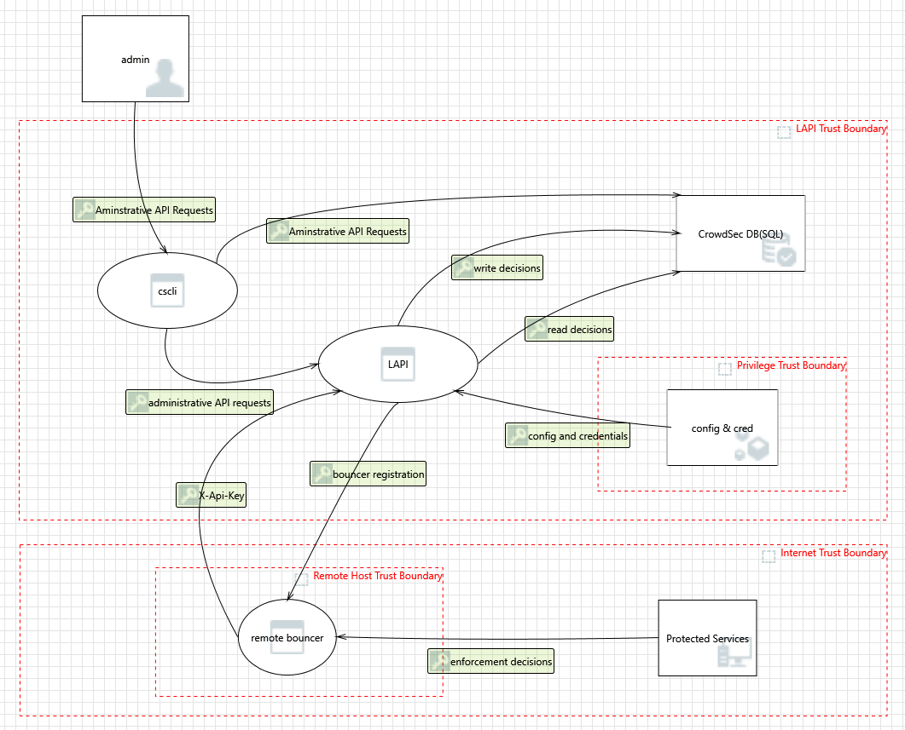
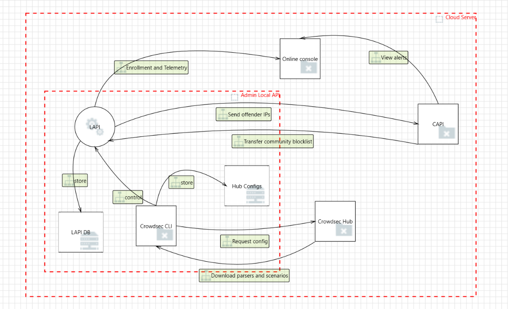

# Threat Modeling — CrowdSec Security Engine
**CSCI-8420 Software Security Engineering · Group 2**
Leonard Meredith (lead) · Kowshik Chowdhury · Mujib Latifi · Trung Phan · Hrudhay Rao Chepyala

<!-- Replace OWNER/REPO everywhere below. Delete HTML comments before submitting. -->

## Contents
1. [Part 1: Threat Modeling](#part-1-threat-modeling)
   - [Scenario-to-DFD mapping](#scenario-to-dfd-mapping)
   - [DFD-1: Detection pipeline](#dfd-1-detection-pipeline)
   - [DFD-2: Remediation path and authentication](#dfd-2-remediation-path-and-authentication)
   - [DFD-3: External and cloud services](#dfd-3-external-and-cloud-services)
   - [Cross-boundary threat summary](#cross-boundary-threat-summary)
   - [AI analysis vs TMT](#ai-analysis-vs-tmt-optional)
2. [Part 2: Observations](#part-2-observations)
   - [Mitigation review](#mitigation-review)
   - [Gaps](#gaps)
   - [Team collaboration](#team-collaboration)
   - [Reflection](#reflection)

---

## Part 1: Threat Modeling

**Approach.** We modeled CrowdSec as three DFDs that together cover all of our prioritized scenarios from the Security Requirements and Assurance Case assignments. Each was drawn and analyzed in the Microsoft Threat Modeling Tool using the *SDL TM Knowledge Base (Core)* template. Shared conventions (element names, trust boundaries, triage format) are in [`threat-model/CONVENTIONS.md`](threat-model/CONVENTIONS.md).

**Trust boundaries used across all diagrams**

| Boundary | Separates |
|---|---|
| Internet Boundary | Public internet (CAPI, Console, Hub, attackers) from the deployment |
| LAPI Host Boundary | The machine running LAPI and its database from everything else |
| Remote Host Boundary | Bouncers/agents on other machines from the LAPI host |
| Privilege Boundary | Root-only resources (credentials, `cscli`) from unprivileged processes |

### Scenario-to-DFD mapping

| Scenario (from earlier assignments) | Misuse case / assurance claim | DFD | Key flows |
|---|---|---|---|
| UC-1 — Ingest & Analyze Logs | MC-1.1, MC-1.2, MC-1.3 / C1 | DFD-1 | Log Files → Security Engine (Agent) → LAPI → CrowdSec DB |
| | | | |

### DFD-1: Detection pipeline
*Owner: Kowshik Chowdhury*

**Full TMT report:** [View HTML report](https://htmlpreview.github.io/?https://github.com/OWNER/REPO/blob/main/threat-modeling/reports/dfd1.htm) · [Model file](dfd1-detection/dfd1-detection.tm7)

**Scope.** DFD-1 models the CrowdSec detection pipeline from local log and configuration/credential files through the `Security Engine (Agent)` to `LAPI` and the `CrowdSec DB`. It covers log acquisition, parser/scenario processing, Agent-to-LAPI machine authentication and alert submission, and LAPI database reads and writes. The main trust changes are the `Remote Host Boundary` between the Agent and LAPI and the `LAPI Host Boundary` protecting LAPI and its database. This DFD primarily supports UC-1 (Ingest & Analyze Logs), including MC-1.1 through MC-1.3 and SR-1.1 through SR-1.5, and supports assurance claim C1 on log-ingestion resilience, source authentication, and source-attribution integrity.

**Triage summary**

| STRIDE | Generated | Mitigated | Not Applicable | Needs Investigation |
|---|---:|---:|---:|---:|
| Spoofing | 6 | 0 | 0 | 6 |
| Tampering | 5 | 0 | 0 | 5 |
| Repudiation | 2 | 0 | 0 | 2 |
| Information Disclosure | 5 | 0 | 0 | 5 |
| Denial of Service | 5 | 0 | 0 | 5 |
| Elevation of Privilege | 8 | 0 | 4 | 4 |
| **Total** | **31** | **0** | **4** | **27** |

**Mitigations for relevant threats**

| ID | Threat (STRIDE) | Element / flow | [XB] | Mitigation | Layer | Quick win / structural |
|---|---|---|---|---|---|---|
| D1-01 | Spoofing / Information Disclosure | Log Files | No | Restrict log-file ownership and permissions so only authorized services and administrators can read or modify acquisition inputs. | deployment/config | Quick win |
| D1-02 | Tampering | Log lines (file read) | No | Validate and safely parse log input; reject malformed or unexpected records and test parsers with crafted input. | code/config | Structural |
| D1-03 | Spoofing / Information Disclosure | Config & Credentials | No | Protect configuration and machine credential files with restrictive ownership, permissions, and least-privilege access. | deployment/config | Quick win |
| D1-04 | Spoofing | Machine login (HTTP/S POST) | Yes | Require authenticated and validated Agent machines before LAPI accepts machine-originated requests. | code/config | Quick win |
| D1-05 | Tampering / Information Disclosure / Spoofing | Machine login + Alerts (HTTP/S POST) | Yes | Protect Agent-to-LAPI traffic with TLS and server certificate verification; use mTLS where the deployment requires stronger mutual authentication. | config/deployment | Quick win |
| D1-06 | Tampering / Elevation of Privilege | Machine login + Alerts (HTTP/S POST) | Yes | Validate API structures, field values, sizes, and authentication data before processing; use safe parsing and reject malformed requests. | code | Structural |
| D1-07 | Denial of Service | Machine login + Alerts (HTTP/S POST) | Yes | Apply request/body-size limits, timeouts, exposure restrictions, monitoring, and resource controls to reduce login or alert flooding. | code/config/deployment | Structural |
| D1-08 | Repudiation | Machine login + Alerts (HTTP/S POST) | Yes | Record authenticated machine identity, timestamp, request type, and processing result in audit-capable logs. | code/process | Structural |
| D1-09 | Elevation of Privilege | LAPI | Yes | Run LAPI with least privilege, keep dependencies patched, and use safe request-processing practices to reduce code-execution impact. | code/deployment | Structural |
| D1-10 | Spoofing / Information Disclosure | CrowdSec DB | No | Protect database location, ownership, permissions, and connection configuration so only LAPI and authorized administrators can access or replace it. | deployment/config | Quick win |
| D1-11 | Denial of Service | CrowdSec DB / LAPI | No | Use monitoring, retention controls, capacity planning, and resource limits to prevent database growth or workload from exhausting resources. | config/deployment | Structural |

### DFD-2: Remediation path and authentication
*Owner: Mujib Latifi*

**Full TMT report:** [View HTML report](https://htmlpreview.github.io/?https://github.com/OWNER/REPO/blob/main/threat-model/reports/dfd2.htm) · [Model file](threat-model/dfd2-remediation/dfd2-remediation.tm7)

**Scope**

The data flow diagram **2**  DFD-2 models the CrowdSec remediation path and authentication mechanisms. The model covers administrative API requests, configuration and credentials, and enforcement, read, and write decisions.

The threat model DFD-2 and its following assessments examine interactions between CrowdSec components and their data flow. The components that are covered by the model are cscli, the Local API (LAPI), remote bouncers, protected services, as well as the CrowdSec SQL database. The model DFD-2 focuses on authentication, authorization, privilege escalation, data integrity, service availability, and protection of the components against unauthorized administrative operations.

Internet boundary, LAPI host boundary, remote host boundary, and privilege boundary are the boundaries that the DFD-2 model considers to model and assess threats. The model reviews the links and communication flows across the boundaries mentioned that require authentication, authorization, input validation, and secure communication controls.

**Triage summary**

| STRIDE | Generated | Mitigated | Not Applicable | Needs Investigation |
|---|---:|---:|---:|---:|
| Spoofing | 8 | 0 | 0 | 8 |
| Tampering | 7 | 0 | 0 | 7 |
| Repudiation | 6 | 0 | 0 | 6 |
| Information Disclosure | 1 | 0 | 0 | 1 |
| Denial of Service | 16 | 0 | 0 | 16 |
| Elevation of Privilege | 9 | 0 | 0 | 9 |
| **Total** | **47** | **0** | **0** | **47** |

**Mitigations for relevant threats**

| ID | Threat (STRIDE) | Element / flow | XB? | Mitigation | Layer | Quick win / structural |
|---|---|---|---|---|---|---|
| D2-01 | Elevation Using Impersonation (EoP) | LAPI / cscli — Administrative API Requests | No | Enforce distinct service identities and least-privilege authorization. Validate the caller identity and permissions for every administrative operation. | Application / Authorization | Quick win: Review service permissions. Structural: Implement service-level identity and authorization policies. |
| D2-02 | cscli Process Memory Tampered (Tampering) | cscli / LAPI — Administrative API Requests | No | Avoid shared-memory access and unsafe pointer passing. Exchange validated data structures instead of executable references. | Application / Process Isolation | Quick win: Review memory-sharing and pointer interfaces. Structural: Use isolated processes and validated message-based communication. |
| D2-03 | Elevation Using Impersonation (EoP) | Admin / cscli — Administrative API Requests | Yes | Authenticate administrators and enforce role-based authorization for administrative commands. | Identity / Application | Quick win: Review administrator permissions. Structural: Enforce centralized authentication, authorization, and privileged-access management. |
| D2-04 | Elevation by Changing the Execution Flow in cscli (EoP) | Admin → cscli — Administrative API Requests | Yes | Validate and constrain all command arguments and API inputs. Prevent untrusted input from controlling execution paths. | Application | Quick win: Validate inputs and reject unexpected values. Structural: Use secure input handling and code-level controls against injection and execution-flow manipulation. |
| D2-05 | cscli Remote Code Execution (EoP) | Admin → cscli — Administrative API Requests | Yes | Prevent remote execution through administrative interfaces. Restrict executable operations and validate all incoming requests. | Application / Host | Quick win: Review exposed administrative operations. Structural: Separate administrative control functions from general API access and enforce least privilege. |
| D2-06 | Administrative API Requests Flow Interrupted (DoS) | Admin ↔ cscli — Administrative API Requests | Yes | Apply request timeouts, rate limits, availability monitoring, and controlled retry behavior. | Network / Application | Quick win: Configure timeouts and rate limits. Structural: Implement resilient API access and availability protections. |
| D2-07 | Potential Process Crash or Stop for cscli (DoS) | cscli — Process | No | Handle exceptions, validate inputs, and monitor process health. Define restart and recovery procedures. | Application / Host | Quick win: Enable process monitoring and restart policies. Structural: Add fault handling, health checks, and resilience testing. |
| D2-08 | Potential Data Repudiation by cscli (Repudiation) | cscli — Administrative API Requests | Yes | Log administrative requests with authenticated identity, timestamp, action, outcome, and relevant request metadata. Protect logs against alteration. | Application / Logging | Quick win: Enable audit logging. Structural: Centralize tamper-resistant audit records and retention controls. |
| D2-09 | Excessive Resource Consumption for cscli or CrowdSec Database (DoS) | cscli / CrowdSec Database — Administrative API Requests | No | Apply resource limits, query timeouts, connection limits, and request throttling. | Application / Database / Host | Quick win: Set query and request timeouts. Structural: Establish resource quotas, workload limits, and database capacity monitoring. |
| D2-10 | SQL Injection Vulnerability (Tampering) | CrowdSec Database — Administrative API Requests | No | Use parameterized queries, safe database APIs, and strict input validation. Review all dynamically constructed SQL. | Application / Database | Quick win: Review SQL construction and parameterization. Structural: Adopt secure database-access patterns and automated injection testing. |
| D2-11 | Spoofing of Destination Data Store (Spoofing) | CrowdSec Database — Administrative API Requests | No | Authenticate the database endpoint and verify its identity. Protect database connection configuration and credentials. | Database / Network | Quick win: Verify database connection settings. Structural: Enforce authenticated database connections and secure secret management. |
| D2-12 | Elevation by Changing the Execution Flow in Remote Bouncer (EoP) | LAPI → Remote Bouncer — bouncer registration | Yes | Validate registration data and prevent untrusted input from controlling bouncer execution. | Application | Quick win: Validate registration inputs. Structural: Use secure protocol handling, input schemas, and execution isolation. |
| D2-13 | Remote Bouncer Remote Code Execution (EoP) | LAPI → Remote Bouncer — bouncer registration | Yes | Restrict registration operations to authenticated and authorized requests. Prevent registration data from being interpreted as executable instructions. | Application / Host | Quick win: Review registration handlers. Structural: Enforce least privilege, secure parsing, and process isolation. |
| D2-14 | Elevation Using Impersonation (EoP) | Remote Bouncer / LAPI — bouncer registration | Yes | Authenticate the remote bouncer independently and prevent it from assuming LAPI identity or privileges. | Identity / Application | Quick win: Verify bouncer authentication. Structural: Use mutual authentication and separate service identities and permissions. |
| D2-15 | bouncer registration Flow Interrupted (DoS) | LAPI ↔ Remote Bouncer — bouncer registration | Yes | Apply connection timeouts, retry limits, rate limiting, and availability monitoring. | Network / Application | Quick win: Configure timeouts and retry limits. Structural: Implement resilient registration and service availability controls. |
| D2-16 | Potential Process Crash or Stop for Remote Bouncer (DoS) | Remote Bouncer — bouncer registration | Yes | Monitor bouncer health, handle malformed requests safely, and implement controlled recovery. | Application / Host | Quick win: Enable health monitoring and restart policies. Structural: Add fault isolation and resilience testing. |
| D2-17 | Potential Data Repudiation by Remote Bouncer (Repudiation) | Remote Bouncer — bouncer registration | Yes | Record registration requests, authenticated bouncer identity, timestamps, and registration outcomes in protected audit logs. | Application / Logging | Quick win: Log registration events. Structural: Centralize tamper-resistant audit logging. |
| D2-18 | Spoofing the LAPI Process (Spoofing) | LAPI / Remote Bouncer — bouncer registration | Yes | Authenticate LAPI to the remote bouncer and validate the identity of the connecting endpoint. | Identity / Network | Quick win: Verify endpoint identity. Structural: Enforce mutual TLS or equivalent authenticated service-to-service communication. |
| D2-19 | HTTPS Data Flow Interrupted (DoS) | config and credentials → LAPI — HTTPS | Yes | Configure connection timeouts, availability monitoring, and secure retry behavior. Protect the service from connection exhaustion. | Network / Application | Quick win: Set connection timeouts. Structural: Implement resilient communication and network-level availability controls. |
| D2-20 | Potential Process Crash or Stop for LAPI (DoS) | LAPI — config and credentials interaction | Yes | Monitor LAPI health, validate configuration inputs, and implement controlled restart and recovery procedures. | Application / Host | Quick win: Enable health checks and restart policies. Structural: Implement fault handling and high-availability design where required. |
| D2-21 | Weak Access Control for a Resource (Information Disclosure) | config and credentials — File | Yes | Restrict file and directory permissions. Limit access to authorized service accounts and administrators. Protect credentials at rest. | Host / File System / Identity | Quick win: Review file permissions. Structural: Use least-privilege access, secret management, and credential rotation. |
| D2-22 | Potential Data Repudiation by LAPI (Repudiation) | LAPI — config and credentials interaction | Yes | Record incoming requests and relevant source identity, timestamps, and processing outcomes. Protect audit records from modification. | Application / Logging | Quick win: Enable request audit logging. Structural: Centralize tamper-resistant logs with defined retention. |
| D2-23 | Spoofing of Source Data Store (Spoofing) | Configuration and Credentials — File → LAPI | Yes | Protect configuration-file integrity and verify the source and ownership of configuration data. | Host / File Integrity | Quick win: Restrict write permissions. Structural: Implement file-integrity monitoring and controlled configuration management. |
| D2-24 | Data Store Inaccessible (DoS) | config and credentials — File → LAPI | Yes | Ensure required configuration and credential files are available and protected against unauthorized deletion or modification. | Host / File System | Quick win: Monitor file availability and permissions. Structural: Implement protected configuration storage, backup, and recovery. |
| D2-25 | Elevation by Changing the Execution Flow in LAPI (EoP) | config and credentials → LAPI | Yes | Validate configuration values and prevent untrusted configuration data from changing execution behavior. | Application | Quick win: Validate configuration inputs. Structural: Use strict configuration schemas, secure parsing, and controlled configuration deployment. |
| D2-26 | LAPI Remote Code Execution (EoP) | config and credentials → LAPI | Yes | Ensure configuration and credential data cannot be interpreted as executable content. Restrict LAPI privileges and validate all configuration inputs. | Application / Host | Quick win: Review configuration parsing and execution paths. Structural: Apply least privilege, secure parsing, and process isolation. |
| D2-27 | Potential Process Crash or Stop for Remote Bouncer (DoS) | Remote Bouncer — enforcement decisions | Yes | Handle invalid or unexpected enforcement data safely. Monitor process health and implement controlled recovery. | Application / Host | Quick win: Enable bouncer health monitoring. Structural: Add fault isolation and resilience testing. |
| D2-28 | Potential Data Repudiation by Remote Bouncer (Repudiation) | Remote Bouncer — enforcement decisions | Yes | Log enforcement-decision receipt, source identity, timestamps, and processing outcomes. Protect logs from alteration. | Application / Logging | Quick win: Log enforcement events. Structural: Centralize tamper-resistant audit records. |
| D2-29 | Spoofing the Protected Services External Entity (Spoofing) | Protected Services → Remote Bouncer — enforcement decisions | Yes | Authenticate the protected service or its communication endpoint. Do not rely solely on network location to establish identity. | Identity / Network | Quick win: Verify source identity. Structural: Enforce authenticated service communication and endpoint authorization. |
| D2-30 | enforcement decisions Flow Interrupted (DoS) | Protected Services → Remote Bouncer — enforcement decisions | Yes | Apply communication timeouts, availability monitoring, and controlled retry behavior. | Network / Application | Quick win: Configure timeouts and monitoring. Structural: Design resilient enforcement communication and recovery. |
| D2-31 | Elevation by Changing the Execution Flow in Remote Bouncer (EoP) | Protected Services → Remote Bouncer — enforcement decisions | Yes | Validate enforcement data and prevent incoming values from controlling execution flow. | Application | Quick win: Validate enforcement inputs. Structural: Use strict message schemas, secure parsing, and execution isolation. |
| D2-32 | Remote Bouncer Remote Code Execution (EoP) | Protected Services → Remote Bouncer — enforcement decisions | Yes | Ensure enforcement data cannot trigger command or code execution. Restrict the bouncer process privileges. | Application / Host | Quick win: Review enforcement handlers. Structural: Enforce least privilege, secure parsing, and process isolation. |
| D2-33 | Elevation Using Impersonation (EoP) | Remote Bouncer / Protected Services — enforcement decisions | Yes | Separate the identities and permissions of the bouncer and protected services. Enforce authorization for each operation. | Identity / Application | Quick win: Review service permissions. Structural: Implement independent service identities and least-privilege authorization. |
| D2-34 | Excessive Resource Consumption for LAPI or CrowdSec Database (DoS) | LAPI / CrowdSec Database — read decisions | No | Apply request limits, database query timeouts, connection limits, and resource quotas. | Application / Database / Host | Quick win: Set query and request timeouts. Structural: Establish resource quotas, workload limits, and database capacity monitoring. |
| D2-35 | SQL Injection Vulnerability (Tampering) | CrowdSec Database — read decisions | No | Use parameterized queries and safe database APIs. Review all dynamically constructed SQL and validate inputs. | Application / Database | Quick win: Review SQL query construction. Structural: Adopt secure database-access patterns and automated injection testing. |
| D2-36 | Spoofing of Destination Data Store (Spoofing) | CrowdSec Database — read decisions | No | Authenticate the database endpoint and verify its identity. Protect database connection configuration and credentials. | Database / Network | Quick win: Verify database connection settings. Structural: Enforce authenticated database connections and secure secret management. |
| D2-37 | Excessive Resource Consumption for LAPI or CrowdSec Database (DoS) | LAPI / CrowdSec Database — write decisions | No | Apply request limits, database query timeouts, connection limits, and resource quotas. | Application / Database / Host | Quick win: Set query and request timeouts. Structural: Establish resource quotas, workload limits, and database capacity monitoring. |
| D2-38 | SQL Injection Vulnerability (Tampering) | CrowdSec Database — write decisions | No | Use parameterized queries and safe database APIs. Review all dynamically constructed SQL and validate inputs. | Application / Database | Quick win: Review SQL query construction. Structural: Adopt secure database-access patterns and automated injection testing. |
| D2-39 | Spoofing of Destination Data Store (Spoofing) | CrowdSec Database — write decisions | No | Authenticate the database endpoint and verify its identity. Protect database connection configuration and credentials. | Database / Network | Quick win: Verify database connection settings. Structural: Enforce authenticated database connections and secure secret management. |
| D2-40 | Elevation by Changing the Execution Flow in LAPI (EoP) | Remote Bouncer → LAPI — X-Api-Key | Yes | Validate and constrain API-key requests. Prevent request data from controlling LAPI execution paths. | Application / API | Quick win: Validate request fields and headers. Structural: Apply secure API design, input validation, and authorization controls. |
| D2-41 | LAPI Remote Code Execution (EoP) | Remote Bouncer → LAPI — X-Api-Key | Yes | Prevent API-key requests from triggering code or command execution. Restrict LAPI privileges and validate all request data. | Application / Host | Quick win: Review API request handlers. Structural: Enforce least privilege, secure parsing, and process isolation. |
| D2-42 | Elevation Using Impersonation (EoP) | LAPI / Remote Bouncer — X-Api-Key | Yes | Ensure LAPI cannot assume remote-bouncer identity or privileges. Enforce separate identities and authorization boundaries. | Identity / Application | Quick win: Review service identity handling. Structural: Implement mutual authentication and least-privilege service authorization. |
| D2-43 | X-Api-Key Data Flow Interrupted (DoS) | Remote Bouncer ↔ LAPI — X-Api-Key | Yes | Apply connection timeouts, rate limits, availability monitoring, and controlled retry behavior. | Network / API | Quick win: Configure timeouts and rate limits. Structural: Implement resilient API communication and availability protections. |
| D2-44 | Potential Process Crash or Stop for LAPI (DoS) | LAPI — X-Api-Key | Yes | Validate API requests, handle exceptions safely, and monitor LAPI health. Implement controlled recovery. | Application / Host | Quick win: Enable health monitoring and restart policies. Structural: Add fault handling and resilience testing. |
| D2-45 | Potential Data Repudiation by LAPI (Repudiation) | LAPI — X-Api-Key | Yes | Log API-key request receipt, authenticated bouncer identity, timestamps, and processing outcomes. Protect audit records from alteration. | Application / Logging | Quick win: Enable API audit logging. Structural: Centralize tamper-resistant audit records and retention controls. |
| D2-46 | Remote Bouncer Process Memory Tampered (Tampering) | Remote Bouncer / LAPI — X-Api-Key | Yes | Avoid shared-memory access and unsafe pointer passing. Exchange validated data structures and isolate the bouncer process. | Application / Process Isolation | Quick win: Review memory-sharing and pointer interfaces. Structural: Use process isolation and validated message-based communication. |
| D2-47 | Spoofing the Remote Bouncer Process (Spoofing) | Remote Bouncer → LAPI — X-Api-Key | Yes | Authenticate the remote bouncer and validate its identity before accepting API-key requests. Protect credentials against theft and reuse. | Identity / API | Quick win: Verify bouncer credentials and identity. Structural: Use mutual authentication, secure secret storage, and credential rotation. |

## Deduplication and similarity notes

The following entries have similar threat templates and could possibly be assumed as duplicates. However, their interaction contexts differ from each other and should remain independently traceable:

| Threat records | Why they remain separate |
|---|---|
| D2-09, D2-34, D2-37 | Resource-consumption threats occur on administrative API requests, reading decisions, and writing decisions. |
| D2-10, D2-35, D2-38 | SQL injection threats are associated with three different database interactions. |
| D2-11, D2-36, D2-39 | Database destination-spoofing threats are associated with three different database interactions. |
| D2-12 and D2-31 | Remote-bouncer execution-flow threats occur on registration and enforcement-decision interactions. |
| D2-13 and D2-32 | Remote-bouncer RCE threats have different interaction sources: LAPI and Protected Services. |
| D2-16 and D2-27 | Remote-bouncer availability threats occur on registration and enforcement-decision interactions. |
| D2-17 and D2-28 | Remote-bouncer repudiation threats occur on registration and enforcement-decision interactions. |

## Important assessment limitations

1. The report marks all 47 threats as Not Started. None of the recommended mitigations above should be interpreted as implemented or verified.
2. The report supplies generated threat descriptions, not evidence that each vulnerability exists.
3. The XB classifications are based on the supplied diagram structure and interaction names. They should be checked against the original diagram before being treated as final.
4. The report does not provide implementation evidence, test results, owners, or mitigation validation.
5. Priority is High for all 47 entries in the source report. No independent risk reassessment has been performed.

### DFD-3: External and cloud services
*Owner: Trung Phan*

**Full TMT report:** [View HTML report](https://htmlpreview.github.io/?https://github.com/OWNER/REPO/blob/main/threat-model/reports/dfd3.htm) · [Model file](threat-model/dfd3-external/dfd3-external.tm7)

**Scope.** This diagram models the external and cloud interactions for the CrowdSec Security Engine across the Internet Boundary, LAPI Host Boundary, and Privilege Boundary. It covers bidirectional signal sharing (offender IPs) and community blocklist synchronization between the Local API (LAPI) and Central API (CAPI), instance enrollment and telemetry reporting to the Online Console, and `cscli` interactions with the CrowdSec Hub to download and store parsers, scenarios, and collections into Hub Configs and LAPI DB.

**Triage summary**

| STRIDE | Generated | Mitigated | Not Applicable | Needs Investigation |
|---|---|---|---|---|
| Spoofing | 6 | 6 | 0 | 0 |
| Tampering | 3 | 3 | 0 | 0 |
| Repudiation | 5 | 5 | 0 | 0 |
| Information Disclosure | 1 | 1 | 0 | 0 |
| Denial of Service | 7 | 7 | 0 | 0 |
| Elevation of Privilege | 5 | 5 | 0 | 0 |
| **Total** | **27** | **27** | **0** | **0** |

**Mitigations for relevant threats**

| ID | Threat (STRIDE) | Element / flow | XB? | Mitigation | Layer | Quick win / structural |
|---|---|---|---|---|---|---|
| D3-01 | Elevation Using Impersonation (EoP) | `control` (Crowdsec CLI → LAPI) | Yes | Require TLS certificate authentication before access | Application / Network | Structural |
| D3-02 | Authenticated Data Flow Compromised (T) | `control` (Crowdsec CLI → LAPI) | Yes | Enforce HTTPS (TLS 1.2 or higher) for all REST API communications | Network | Quick win |
| D3-03 | Data Flow Is Potentially Interrupted (DoS) | `Download parsers and scenarios` (Crowdsec Hub → Crowdsec CLI) | Yes | Implement automated cron jobs with retry logic to periodically run `cscli` updates to ensure configurations stay current | Operations | Quick win |
| D3-04 | External Entity Potentially Denies Receiving Data (R) | `Download parsers and scenarios` (Crowdsec Hub → Crowdsec CLI) | Yes | Monitor and audit `cscli` execution logs and retry if needed | Operations / Application | Quick win |
| D3-05 | Data Flow Is Potentially Interrupted (DoS) | `Enrollment and Telemetry` (LAPI → Online console) | Yes | Configure LAPI to queue console telemetry locally and retry transmission automatically when network connection is restored | Application | Structural |
| D3-06 | External Entity Potentially Denies Receiving Data (R) | `Enrollment and Telemetry` (LAPI → Online console) | Yes | Log successful telemetry transmissions and enrollment handshakes locally on LAPI | Application | Quick win |
| D3-07 | Spoofing of External Destination Entity (S) | `Enrollment and Telemetry` (LAPI → Online console) | Yes | Require TLS certificate authentication before access | Network / Application | Quick win |
| D3-08 | Data Flow Is Potentially Interrupted (DoS) | `Request config` (Crowdsec CLI → Crowdsec Hub) | Yes | Ensure resilient outbound network routing and implement retry logic for `cscli hub update` commands | Operations / Network | Quick win |
| D3-09 | External Entity Potentially Denies Receiving Data (R) | `Request config` (Crowdsec CLI → Crowdsec Hub) | Yes | Enable detailed local logging of all outbound HTTP requests and response codes from `cscli` to the Hub | Application | Quick win |
| D3-10 | Data Flow Is Potentially Interrupted (DoS) | `Send offender IPs` (LAPI → CAPI) | Yes | Configure LAPI to locally queue and cache offender IPs during network outages, transmitting them when connectivity is restored | Application | Structural |
| D3-11 | External Entity Potentially Denies Receiving Data (R) | `Send offender IPs` (LAPI → CAPI) | Yes | Log HTTP 200 OK responses in LAPI after successfully pushing offender IP signals | Application | Quick win |
| D3-12 | Spoofing of External Destination Entity (S) | `Send offender IPs` (LAPI → CAPI) | Yes | Enforce strict TLS certificate validation (verifying the CA chain) in the LAPI when pushing signals | Network / Application | Quick win |
| D3-13 | Spoofing of Destination Data Store (S) | `store` (Crowdsec CLI → Hub Configs) | No | Enforce strict file system permissions | OS / Host | Quick win |
| D3-14 | Spoofing of Destination Data Store (S) | `store` (LAPI → LAPI DB) | No | Restrict OS-level file permissions or use strong authentication for DB | OS / Database | Quick win |
| D3-15 | Potential Excessive Resource Consumption (DoS) | `store` (LAPI → LAPI DB) | No | Limit resource usage for each connection at the OS level | OS / Host | Structural |
| D3-16 | Authenticated Data Flow Compromised (T) | `store` (LAPI → LAPI DB) | No | Enforce HTTPS (TLS 1.2 or higher) for all REST API communications | Network | Quick win |
| D3-17 | Cross Site Request Forgery (EoP) | `Transfer community blocklist` (CAPI → LAPI) | Yes | Apply input validation and sanitize with escape characters; rely strictly on auth headers (API keys/tokens) for M2M traffic and reject session cookies | Application | Structural |
| D3-18 | Elevation by Changing Execution Flow in LAPI (EoP) | `Transfer community blocklist` (CAPI → LAPI) | Yes | Apply input validation on all external data and ensure LAPI operates with OS-level exploit mitigations enabled | Application / OS | Structural |
| D3-19 | Elevation of Privilege Using Remote Code Execution (EoP) | `Transfer community blocklist` (CAPI → LAPI) | Yes | Keep CAPI software updated and implement least-privilege processes for all users | Operations / OS | Structural |
| D3-20 | Elevation Using Impersonation (EoP) | `Transfer community blocklist` (CAPI → LAPI) | Yes | Validate TLS certificates and check payload signatures where applicable | Application / Network | Structural |
| D3-21 | Data Flow Is Potentially Interrupted (DoS) | `Transfer community blocklist` (CAPI → LAPI) | Yes | Cache most recent downloaded community blocklist in local LAPI DB so enforcement continues during cloud outages | Application | Structural |
| D3-22 | Potential Process Crash or Stop for LAPI (DoS) | `Transfer community blocklist` (CAPI → LAPI) | Yes | Manage LAPI with a process manager (`systemd`) with an automatic restart policy and monitor service uptime | Operations / OS | Quick win |
| D3-23 | Data Flow Sniffing (I) | `Transfer community blocklist` (CAPI → LAPI) | Yes | Enforce HTTPS (TLS 1.2 or higher) for all REST API communications | Network | Quick win |
| D3-24 | Potential Data Repudiation by LAPI (R) | `Transfer community blocklist` (CAPI → LAPI) | Yes | Enable detailed audit logging in LAPI to record the receipt, timestamp, and summary of all downloaded community blocklists | Application | Quick win |
| D3-25 | Potential Lack of Input Validation for LAPI (T) | `Transfer community blocklist` (CAPI → LAPI) | Yes | Apply input validation for any HTTP request to LAPI and sanitize JSON/YAML blocklist payloads before writing to the database | Application | Structural |
| D3-26 | Spoofing the CAPI External Entity (S) | `Transfer community blocklist` (CAPI → LAPI) | Yes | Enforce strict TLS certificate validation in LAPI to ensure it only pulls blocklists from legitimate CrowdSec CAPI | Network / Application | Quick win |
| D3-27 | Spoofing the LAPI Process (S) | `Transfer community blocklist` (CAPI → LAPI) | Yes | Require strong, unique API keys for LAPI authentication to CAPI | Application | Quick win |

### Cross-boundary threat summary
<!-- Lead: pull every [XB] threat from the three tables. This is the section graders look for. -->

| ID | Boundary crossed | Flow | Threat | Mitigation | Priority |
|---|---|---|---|---|---|
| D3-01 | Privilege / LAPI Host Boundary | `control` (Crowdsec CLI → LAPI) | Elevation Using Impersonation (EoP) | Require TLS cert auth before access | High |
| D3-02 | Privilege / LAPI Host Boundary | `control` (Crowdsec CLI → LAPI) | Authenticated Data Flow Compromised (T) | Enforce HTTPS (TLS 1.2+) for all REST API communications | High |
| D3-03 | Internet Boundary | `Download parsers and scenarios` (Crowdsec Hub → Crowdsec CLI) | Data Flow Interrupted (DoS) | Automated cron jobs with retry logic for `cscli` updates | High |
| D3-04 | Internet Boundary | `Download parsers and scenarios` (Crowdsec Hub → Crowdsec CLI) | External Entity Denies Receiving Data (R) | Monitor and audit `cscli` execution logs; retry if needed | High |
| D3-05 | Internet / LAPI Host Boundary | `Enrollment and Telemetry` (LAPI → Online console) | Data Flow Interrupted (DoS) | Queue console telemetry locally and retry automatically when restored | High |
| D3-06 | Internet / LAPI Host Boundary | `Enrollment and Telemetry` (LAPI → Online console) | External Entity Denies Receiving Data (R) | Log successful telemetry transmissions and enrollment handshakes locally | High |
| D3-07 | Internet / LAPI Host Boundary | `Enrollment and Telemetry` (LAPI → Online console) | Spoofing of Online console (S) | Require TLS cert auth before access | High |
| D3-08 | Internet Boundary | `Request config` (Crowdsec CLI → Crowdsec Hub) | Data Flow Interrupted (DoS) | Ensure resilient outbound routing and retry logic for `cscli hub update` | High |
| D3-09 | Internet Boundary | `Request config` (Crowdsec CLI → Crowdsec Hub) | External Entity Denies Receiving Data (R) | Enable detailed local logging of outbound HTTP requests/responses | High |
| D3-10 | Internet / LAPI Host Boundary | `Send offender IPs` (LAPI → CAPI) | Data Flow Interrupted (DoS) | Locally queue and cache offender IPs during outages; transmit when restored | High |
| D3-11 | Internet / LAPI Host Boundary | `Send offender IPs` (LAPI → CAPI) | External Entity Denies Receiving Data (R) | Log HTTP 200 OK responses in LAPI after pushing offender IP signals | High |
| D3-12 | Internet / LAPI Host Boundary | `Send offender IPs` (LAPI → CAPI) | Spoofing of CAPI Destination (S) | Enforce strict TLS certificate validation (CA chain) when pushing signals | High |
| D3-17 | Internet / LAPI Host Boundary | `Transfer community blocklist` (CAPI → LAPI) | Cross Site Request Forgery (EoP) | Input validation/escaping; rely strictly on API key/token headers, reject cookies | High |
| D3-18 | Internet / LAPI Host Boundary | `Transfer community blocklist` (CAPI → LAPI) | Elevation by Changing Execution Flow (EoP) | Input validation on external data and OS-level exploit mitigations enabled | High |
| D3-19 | Internet / LAPI Host Boundary | `Transfer community blocklist` (CAPI → LAPI) | Elevation Using RCE (EoP) | Keep CAPI software updated and enforce least-privilege processes | High |
| D3-20 | Internet / LAPI Host Boundary | `Transfer community blocklist` (CAPI → LAPI) | Elevation Using Impersonation (EoP) | Validate TLS certificates and check payload signatures where applicable | High |
| D3-21 | Internet / LAPI Host Boundary | `Transfer community blocklist` (CAPI → LAPI) | Data Flow Interrupted (DoS) | Cache most recent community blocklist in local LAPI DB for offline enforcement | High |
| D3-22 | Internet / LAPI Host Boundary | `Transfer community blocklist` (CAPI → LAPI) | Process Crash or Stop for LAPI (DoS) | Manage LAPI with `systemd` automatic restart policy and monitor uptime | High |
| D3-23 | Internet / LAPI Host Boundary | `Transfer community blocklist` (CAPI → LAPI) | Data Flow Sniffing (I) | Enforce HTTPS (TLS 1.2+) for all REST API communications | High |
| D3-24 | Internet / LAPI Host Boundary | `Transfer community blocklist` (CAPI → LAPI) | Data Repudiation by LAPI (R) | Detailed audit logging in LAPI for receipt, timestamp, and summary of blocklists | High |
| D3-25 | Internet / LAPI Host Boundary | `Transfer community blocklist` (CAPI → LAPI) | Lack of Input Validation for LAPI (T) | Validate HTTP requests and sanitize JSON/YAML blocklist payloads before DB write | High |
| D3-26 | Internet / LAPI Host Boundary | `Transfer community blocklist` (CAPI → LAPI) | Spoofing CAPI External Entity (S) | Enforce strict TLS certificate validation in LAPI when pulling blocklists | High |
| D3-27 | Internet / LAPI Host Boundary | `Transfer community blocklist` (CAPI → LAPI) | Spoofing the LAPI Process (S) | Require strong, unique API keys for LAPI authentication to CAPI | High |

**Design guardrails.**
- **Enforced HTTPS (TLS 1.2+) with strict certificate/TLS validation and header-only API authentication across all cross-boundary flows:** Requiring verified TLS certificates (CA chain validation for `CAPI`, `Online console`, and `Crowdsec Hub`, plus client certificates or unique API keys via headers for `LAPI` and `cscli`) and rejecting browser session cookies eliminates entire classes of network sniffing (`I`), MitM tampering (`T`), endpoint spoofing (`S`), and CSRF (`E`) threats (mitigating D3-01, D3-02, D3-07, D3-12, D3-16, D3-17, D3-20, D3-23, D3-26, D3-27).
- **Strict schema validation and payload sanitization at all ingestion boundaries:** Validating and sanitizing all inbound JSON/YAML payloads (community blocklists from `CAPI`, parsers/scenarios from `Crowdsec Hub`) before database insertion or execution prevents injection, remote code execution, and control-flow tampering (`T`, `E`) across LAPI and local data stores (mitigating D3-17, D3-18, D3-25).
- **Local caching, asynchronous queueing, and automated retry with service supervision:** Caching community blocklists in `LAPI DB`, queueing outbound offender IP signals and console telemetry during cloud outages, and managing `LAPI` and `cscli` updates via `systemd` restart policies and retry-enabled cron jobs neutralize external availability disruptions and process crashes (`D`) (mitigating D3-03, D3-05, D3-08, D3-10, D3-21, D3-22).
- **OS-level least privilege, file permission lockdown, and audit logging:** Running CrowdSec services under least-privilege accounts with restricted file permissions on `LAPI DB` and `Hub Configs`, paired with comprehensive local logging of all REST handshakes and `cscli` updates, eliminates local data store spoofing (`S`), resource exhaustion (`D`), and cross-boundary repudiation (`R`) (mitigating D3-04, D3-06, D3-09, D3-11, D3-13, D3-14, D3-15, D3-19, D3-24).

### AI analysis vs TMT (optional)
*Owner: Hrudhay Rao Chepyala*

We ran the instructor's STRIDE-per-Interaction prompt on each final DFD. Raw outputs: [`threat-model/ai/`](threat-model/ai/).

| DFD | Found by both | TMT only | AI only | AI noise / incorrect |
|---|---|---|---|---|
| DFD-1 | | | | |
| DFD-2 | | | | |
| DFD-3 | | | | |

**What each approach missed.** <!-- short paragraph -->

**Top 10 threats by likelihood × impact**

| Rank | ID | Threat | Likelihood | Impact | Rationale |
|---|---|---|---|---|---|
| 1 | | | | | |

**Derived test cases / requirements (optional)**

| Threat ID | Abuse test or requirement |
|---|---|
| | |

---

## Part 2: Observations

### Mitigation review
*Consolidated by Hrudhay Rao Chepyala from each DFD owner's code review.*

We checked the CrowdSec source, documentation and default configuration for each expected mitigation.

| Mitigation ID | Expected control | Status | Evidence | Notes |
|---|---|---|---|---|
| D2-xx | | Present / Partial / Absent | [link]() | |

**Summary:** <!-- X of Y expected mitigations present, Z partial, W absent -->

### Gaps
<!-- Highlight: each Absent/Partial item, why it matters, which threat stays open. Separate "secure option exists but not default" from "not implemented". -->

| Gap | Threat left open | Default config or missing in code? | Impact | Recommendation |
|---|---|---|---|---|
| | | | | |

### Team collaboration
Task assignments, issues and progress: **[Project board](https://github.com/users/OWNER/projects/N)** · [Issues for this assignment](https://github.com/OWNER/REPO/issues?q=label%3Athreat-model)

| Member | Responsibilities |
|---|---|
| Leonard Meredith | Lead: conventions, boundary review, report hosting, assembly, submission |
| Kowshik Chowdhury | DFD-1 detection pipeline, TMT analysis, Part 2 code review |
| Mujib Latifi | DFD-2 remediation & auth, TMT analysis, Part 2 code review |
| Trung Phan | DFD-3 external/cloud, TMT analysis, Part 2 code review |
| Hrudhay Rao Chepyala | AI STRIDE analysis & comparison, prioritization, Part 2 consolidation |

### Reflection
<!-- Lead: compile from the reflections issue. Organize by theme, not by person; attribute specific points where it helps. -->

**What we learned**

**What we found most useful**

**What we would do differently**

---

<!--
SUBMISSION CHECKLIST (delete before submitting)
Part 1
[ ] DFDs cover every prioritized scenario (mapping table filled)
[ ] Diagrams drawn and analyzed in TMT; final Level 1/2 only triaged
[ ] Every generated threat has a state + justification
[ ] Mitigations documented for relevant threats
[ ] Cross-boundary threats called out
[ ] Full HTML report per DFD, hosted in repo, htmlpreview links tested in a private window
[ ] (Optional) AI comparison done
Part 2
[ ] Mitigation review with evidence links
[ ] Gaps highlighted
[ ] Link to GitHub repo/board showing assignments and collaboration
[ ] Team reflection compiled from individual reflections
Submission
[ ] OWNER/REPO and project number replaced everywhere
[ ] All images render on GitHub
[ ] Canvas submission = link to this file
-->
