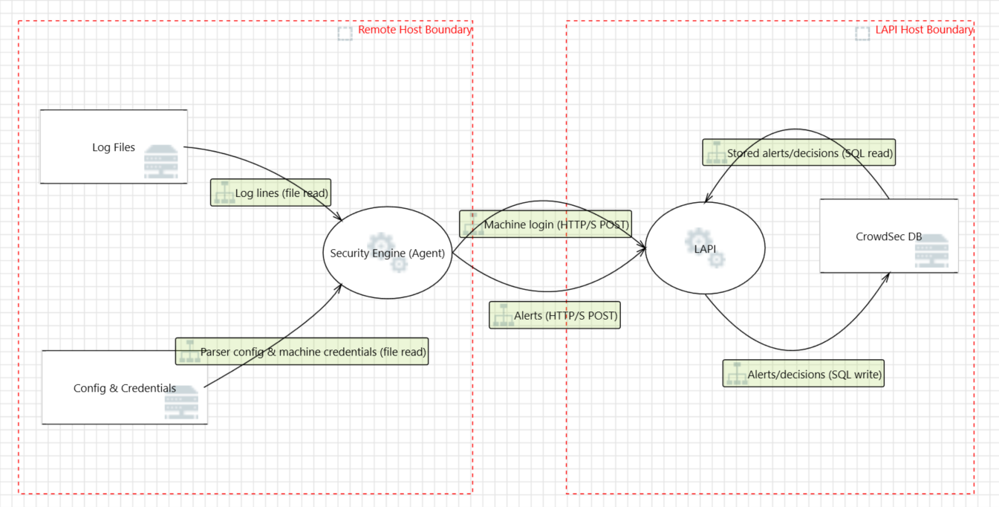

# Threat Modeling — CrowdSec Security Engine
**CSCI-8420 Software Security Engineering · Group 2**
Leonard Meredith (lead) · Kowshik Chowdhury · Mujib Latifi · Trung Phan · Hrudhay Rao Chepyala

<!-- Replace OWNER/REPO everywhere below. Delete HTML comments before submitting. -->

## Contents
1. [Part 1: Threat Modeling](#part-1-threat-modeling)
   - [Scenario-to-DFD mapping](#scenario-to-dfd-mapping)
   - [DFD-1: Detection pipeline](#dfd-1-detection-pipeline)
   - [DFD-2: Remediation path and authentication](#dfd-2-remediation-path-and-authentication)
   - [DFD-3: External and cloud services](#dfd-3-external-and-cloud-services)
   - [Cross-boundary threat summary](#cross-boundary-threat-summary)
   - [AI analysis vs TMT](#ai-analysis-vs-tmt-optional)
2. [Part 2: Observations](#part-2-observations)
   - [Mitigation review](#mitigation-review)
   - [Gaps](#gaps)
   - [Team collaboration](#team-collaboration)
   - [Reflection](#reflection)

---

## Part 1: Threat Modeling

**Approach.** We modeled CrowdSec as three DFDs that together cover all of our prioritized scenarios from the Security Requirements and Assurance Case assignments. Each was drawn and analyzed in the Microsoft Threat Modeling Tool using the *SDL TM Knowledge Base (Core)* template. Shared conventions (element names, trust boundaries, triage format) are in [`threat-model/CONVENTIONS.md`](threat-model/CONVENTIONS.md).

**Trust boundaries used across all diagrams**

| Boundary | Separates |
|---|---|
| Internet Boundary | Public internet (CAPI, Console, Hub, attackers) from the deployment |
| LAPI Host Boundary | The machine running LAPI and its database from everything else |
| Remote Host Boundary | Bouncers/agents on other machines from the LAPI host |
| Privilege Boundary | Root-only resources (credentials, `cscli`) from unprivileged processes |

### Scenario-to-DFD mapping

| Scenario (from earlier assignments) | Misuse case / assurance claim | DFD | Key flows |
|---|---|---|---|
| UC-1 — Ingest & Analyze Logs | MC-1.1, MC-1.2, MC-1.3 / C1 | DFD-1 | Log Files → Security Engine (Agent) → LAPI → CrowdSec DB |
| | | | |

### DFD-1: Detection pipeline
*Owner: Kowshik Chowdhury*

**Full TMT report:** [View HTML report](https://htmlpreview.github.io/?https://github.com/OWNER/REPO/blob/main/threat-modeling/reports/dfd1.htm) · [Model file](dfd1-detection/dfd1-detection.tm7)

**Scope.** DFD-1 models the CrowdSec detection pipeline from local log and configuration/credential files through the `Security Engine (Agent)` to `LAPI` and the `CrowdSec DB`. It covers log acquisition, parser/scenario processing, Agent-to-LAPI machine authentication and alert submission, and LAPI database reads and writes. The main trust changes are the `Remote Host Boundary` between the Agent and LAPI and the `LAPI Host Boundary` protecting LAPI and its database. This DFD primarily supports UC-1 (Ingest & Analyze Logs), including MC-1.1 through MC-1.3 and SR-1.1 through SR-1.5, and supports assurance claim C1 on log-ingestion resilience, source authentication, and source-attribution integrity.

**Triage summary**

| STRIDE | Generated | Mitigated | Not Applicable | Needs Investigation |
|---|---:|---:|---:|---:|
| Spoofing | 6 | 0 | 0 | 6 |
| Tampering | 5 | 0 | 0 | 5 |
| Repudiation | 2 | 0 | 0 | 2 |
| Information Disclosure | 5 | 0 | 0 | 5 |
| Denial of Service | 5 | 0 | 0 | 5 |
| Elevation of Privilege | 8 | 0 | 4 | 4 |
| **Total** | **31** | **0** | **4** | **27** |

**Mitigations for relevant threats**

| ID | Threat (STRIDE) | Element / flow | [XB] | Mitigation | Layer | Quick win / structural |
|---|---|---|---|---|---|---|
| D1-01 | Spoofing / Information Disclosure | Log Files | No | Restrict log-file ownership and permissions so only authorized services and administrators can read or modify acquisition inputs. | deployment/config | Quick win |
| D1-02 | Tampering | Log lines (file read) | No | Validate and safely parse log input; reject malformed or unexpected records and test parsers with crafted input. | code/config | Structural |
| D1-03 | Spoofing / Information Disclosure | Config & Credentials | No | Protect configuration and machine credential files with restrictive ownership, permissions, and least-privilege access. | deployment/config | Quick win |
| D1-04 | Spoofing | Machine login (HTTP/S POST) | Yes | Require authenticated and validated Agent machines before LAPI accepts machine-originated requests. | code/config | Quick win |
| D1-05 | Tampering / Information Disclosure / Spoofing | Machine login + Alerts (HTTP/S POST) | Yes | Protect Agent-to-LAPI traffic with TLS and server certificate verification; use mTLS where the deployment requires stronger mutual authentication. | config/deployment | Quick win |
| D1-06 | Tampering / Elevation of Privilege | Machine login + Alerts (HTTP/S POST) | Yes | Validate API structures, field values, sizes, and authentication data before processing; use safe parsing and reject malformed requests. | code | Structural |
| D1-07 | Denial of Service | Machine login + Alerts (HTTP/S POST) | Yes | Apply request/body-size limits, timeouts, exposure restrictions, monitoring, and resource controls to reduce login or alert flooding. | code/config/deployment | Structural |
| D1-08 | Repudiation | Machine login + Alerts (HTTP/S POST) | Yes | Record authenticated machine identity, timestamp, request type, and processing result in audit-capable logs. | code/process | Structural |
| D1-09 | Elevation of Privilege | LAPI | Yes | Run LAPI with least privilege, keep dependencies patched, and use safe request-processing practices to reduce code-execution impact. | code/deployment | Structural |
| D1-10 | Spoofing / Information Disclosure | CrowdSec DB | No | Protect database location, ownership, permissions, and connection configuration so only LAPI and authorized administrators can access or replace it. | deployment/config | Quick win |
| D1-11 | Denial of Service | CrowdSec DB / LAPI | No | Use monitoring, retention controls, capacity planning, and resource limits to prevent database growth or workload from exhausting resources. | config/deployment | Structural |

### DFD-2: Remediation path and authentication
*Owner: Mujib Latifi*

**Full TMT report:** [View HTML report](https://htmlpreview.github.io/?https://github.com/OWNER/REPO/blob/main/threat-model/reports/dfd2.htm) · [Model file](threat-model/dfd2-remediation/dfd2-remediation.tm7)

**Scope.**

**Triage summary**

| STRIDE | Generated | Mitigated | Not Applicable | Needs Investigation |
|---|---|---|---|---|
| Spoofing | | | | |
| Tampering | | | | |
| Repudiation | | | | |
| Information Disclosure | | | | |
| Denial of Service | | | | |
| Elevation of Privilege | | | | |
| **Total** | | | | |

**Mitigations for relevant threats**

| ID | Threat (STRIDE) | Element / flow | XB? | Mitigation | Layer | Quick win / structural |
|---|---|---|---|---|---|---|
| D2-01 | | | | | | |

### DFD-3: External and cloud services
*Owner: Trung Phan*

**Full TMT report:** [View HTML report](https://htmlpreview.github.io/?https://github.com/OWNER/REPO/blob/main/threat-model/reports/dfd3.htm) · [Model file](threat-model/dfd3-external/dfd3-external.tm7)

**Scope.**

**Triage summary**

| STRIDE | Generated | Mitigated | Not Applicable | Needs Investigation |
|---|---|---|---|---|
| Spoofing | | | | |
| Tampering | | | | |
| Repudiation | | | | |
| Information Disclosure | | | | |
| Denial of Service | | | | |
| Elevation of Privilege | | | | |
| **Total** | | | | |

**Mitigations for relevant threats**

| ID | Threat (STRIDE) | Element / flow | XB? | Mitigation | Layer | Quick win / structural |
|---|---|---|---|---|---|---|
| D3-01 | | | | | | |

### Cross-boundary threat summary
<!-- Lead: pull every [XB] threat from the three tables. This is the section graders look for. -->

| ID | Boundary crossed | Flow | Threat | Mitigation | Priority |
|---|---|---|---|---|---|
| | | | | | |

**Design guardrails.** <!-- 2–4 controls that remove whole classes of threats, e.g. "mutual TLS required on every cross-host flow" -->

### AI analysis vs TMT (optional)
*Owner: Hrudhay Rao Chepyala*

We ran the instructor's STRIDE-per-Interaction prompt on each final DFD. Raw outputs: [`threat-model/ai/`](threat-model/ai/).

| DFD | Found by both | TMT only | AI only | AI noise / incorrect |
|---|---|---|---|---|
| DFD-1 | | | | |
| DFD-2 | | | | |
| DFD-3 | | | | |

**What each approach missed.** <!-- short paragraph -->

**Top 10 threats by likelihood × impact**

| Rank | ID | Threat | Likelihood | Impact | Rationale |
|---|---|---|---|---|---|
| 1 | | | | | |

**Derived test cases / requirements (optional)**

| Threat ID | Abuse test or requirement |
|---|---|
| | |

---

## Part 2: Observations

### Mitigation review
*Consolidated by Hrudhay Rao Chepyala from each DFD owner's code review.*

We checked the CrowdSec source, documentation and default configuration for each expected mitigation.

| Mitigation ID | Expected control | Status | Evidence | Notes |
|---|---|---|---|---|
| D2-xx | | Present / Partial / Absent | [link]() | |

**Summary:** <!-- X of Y expected mitigations present, Z partial, W absent -->

### Gaps
<!-- Highlight: each Absent/Partial item, why it matters, which threat stays open. Separate "secure option exists but not default" from "not implemented". -->

| Gap | Threat left open | Default config or missing in code? | Impact | Recommendation |
|---|---|---|---|---|
| | | | | |

### Team collaboration
Task assignments, issues and progress: **[Project board](https://github.com/users/OWNER/projects/N)** · [Issues for this assignment](https://github.com/OWNER/REPO/issues?q=label%3Athreat-model)

| Member | Responsibilities |
|---|---|
| Leonard Meredith | Lead: conventions, boundary review, report hosting, assembly, submission |
| Kowshik Chowdhury | DFD-1 detection pipeline, TMT analysis, Part 2 code review |
| Mujib Latifi | DFD-2 remediation & auth, TMT analysis, Part 2 code review |
| Trung Phan | DFD-3 external/cloud, TMT analysis, Part 2 code review |
| Hrudhay Rao Chepyala | AI STRIDE analysis & comparison, prioritization, Part 2 consolidation |

### Reflection
<!-- Lead: compile from the reflections issue. Organize by theme, not by person; attribute specific points where it helps. -->

**What we learned**

**What we found most useful**

**What we would do differently**

---

<!--
SUBMISSION CHECKLIST (delete before submitting)
Part 1
[ ] DFDs cover every prioritized scenario (mapping table filled)
[ ] Diagrams drawn and analyzed in TMT; final Level 1/2 only triaged
[ ] Every generated threat has a state + justification
[ ] Mitigations documented for relevant threats
[ ] Cross-boundary threats called out
[ ] Full HTML report per DFD, hosted in repo, htmlpreview links tested in a private window
[ ] (Optional) AI comparison done
Part 2
[ ] Mitigation review with evidence links
[ ] Gaps highlighted
[ ] Link to GitHub repo/board showing assignments and collaboration
[ ] Team reflection compiled from individual reflections
Submission
[ ] OWNER/REPO and project number replaced everywhere
[ ] All images render on GitHub
[ ] Canvas submission = link to this file
-->
